<a href="https://github.com/parsa-kraken/parsa-kraken">
  <picture>
    <source media="(prefers-color-scheme: dark)" srcset="https://raw.githubusercontent.com/parsa-kraken/parsa-kraken/main/dark.svg">
    
  </picture>
</a>

<!-- =================================================================== -->
<!--                       LIVE CONTRIBUTION SNAKE                       -->
<!--   Real GitHub contribution data on a "commit log" board: totals,     -->
<!--   active days, longest streak, busiest day + a 9-segment snake that  -->
<!--   eats the BIGGEST commits first. Auto-updated daily by GitHub       -->
<!--   Actions workflow (.github/workflows/update-snake.yml).             -->
<!--   Re-style it locally via: python scripts/build_snake.py             -->
<!-- =================================================================== -->

  <picture>
    <source media="(prefers-color-scheme: dark)" srcset="https://raw.githubusercontent.com/parsa-kraken/parsa-kraken/main/dist/github-snake-dark.svg">
    
  </picture>

<!-- =================================================================== -->
<!--                    CYBERPUNK PROFILE SECTIONS                       -->
<!--   6 personalized panels, minimal cyberpunk UI:                      -->
<!--   deep black #111119 / violet #8B35FF / neon pink #D500F9 /          -->
<!--   electric blue #00D9FF / neon yellow #FFE500.                       -->
<!--   The Matrix terminal header above keeps its own retro-green look.  -->
<!--   Re-generate sections via: python scripts/build_sections.py        -->
<!--   Re-generate header via:   python build_profile.py                 -->
<!-- =================================================================== -->

  

  

  

  

  

<!-- =================================================================== -->
<!--                  LIVE GITHUB STATS (PARTICLE NETWORK)               -->
<!-- =================================================================== -->

  

  
  &nbsp;
  
  &nbsp;
  

  

